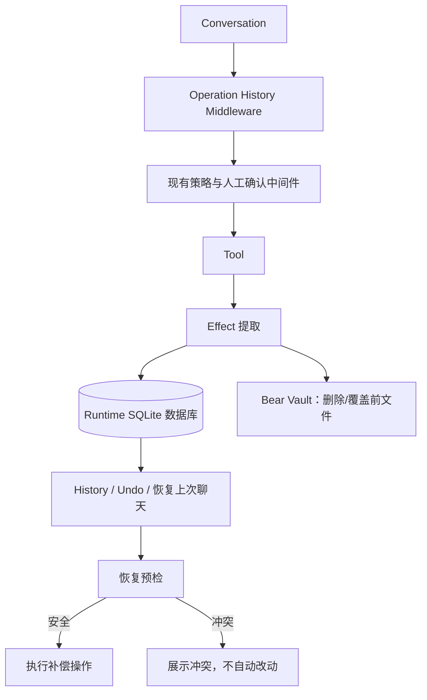

# Bear Runtime：工具操作历史与恢复设计

## 1. 目标

为 Bear Agent 增加一套本地、持久化的工具操作历史，使用户能够：

- 查看本次或过往聊天中 Bear 实际调用过的工具；
- 撤销一项可恢复的文件变更；
- 将文件系统恢复到上一次聊天开始前的 Bear 操作状态；
- 在文件被人工或其他程序修改后，安全地识别冲突而不误删或覆盖用户数据。

本设计借鉴 Git 的两项原则：历史追加、撤销产生新的记录。它不是 Git，也不实现仓库、提交、分支、合并、快照或文件版本控制。

## 2. 非目标

本期不实现：

- 任意时间点的全盘快照或系统还原；
- 对用户在 Bear 之外编辑的文件内容做版本管理；
- 自动合并文件内容；
- 强制覆盖人工改动；
- 多设备同步历史；
- Planner、Task 或复杂的工作流系统。

Bear 只负责恢复它自己造成的、可验证的文件位置、名称、复制、删除和权限变化。

## 3. 核心决策

### 3.1 使用“可撤销操作日志”，不使用 Git 模型

每次工具调用产生一条历史操作。文件变更类操作还会保存恢复所需的数据。用户看到的是操作历史，而不是底层 Tool 调用细节。

### 3.2 聊天是恢复范围

每个聊天会话拥有一个 `conversation_id`。用户说“恢复到上次聊天前”时，Bear 恢复上一个已结束会话中尚未撤销的文件变更操作。

### 3.3 恢复必须先预检

Bear 永远不因为 Undo 而盲目覆盖、删除或移动人工修改后的文件。恢复前先验证当前文件系统是否仍符合原操作完成后的预期状态。

### 3.4 非永久删除使用 Bear 可恢复区

若承诺删除可恢复，不能只依赖系统回收站。Bear 必须将可恢复删除的文件放入自己可追踪的恢复区，并保存原始路径和操作标识。

## 4. 术语

| 术语 | 含义 |
| --- | --- |
| Conversation | 一次 Bear 聊天会话，从新建会话到退出、显式结束或切换会话。 |
| Operation | 一次工具调用的用户可理解记录，例如“移动 53 个文件”。 |
| Effect | Operation 实际造成的逐文件变化。一个批量 Operation 可包含多个 Effect。 |
| Undo | 针对一个 Operation 的补偿操作。Undo 本身也是新的 Operation。 |
| Conversation Restore | 针对一个 Conversation 中多项 Operation 的倒序 Undo。 |
| Bear Vault | Bear 管理的本地可恢复区，用于保存删除前或覆盖前的文件。 |
| Conflict | 当前状态已不满足安全恢复条件，Bear 暂停自动恢复并向用户报告。 |

## 5. 总体结构



`OperationHistoryMiddleware` 是 Runtime 的唯一接入点；Tool 仍只负责执行文件操作，不写历史。它应位于现有中间件链的最外层，以便记录成功、策略拒绝、人工取消与工具失败等最终结果。策略中间件清理后的参数应作为最终执行参数保存。

## 6. 数据模型

持久化采用本地 SQLite。历史以追加事件保存，界面需要的 Operation 状态由事件投影得到；因此不会因 Undo 或失败而改写过去的事实。

### 6.1 Conversation

```python
Conversation(
    id: str,
    started_at: datetime,
    ended_at: datetime | None,
    title: str | None,
)
```

CLI 会话启动时创建 Conversation；用户退出、显式新建聊天或切换聊天时关闭它。当前固定的 `cli-session` 线程标识不能代表长期历史，会由 Conversation ID 替代。

### 6.2 Operation 与事件

```python
Operation(
    id: str,
    conversation_id: str,
    tool: str,
    category: Literal["read", "mutation", "configuration", "undo"],
    risk: str,
    summary: str,
    undoable: bool,
    undo_of: str | None,
    created_at: datetime,
)

OperationEvent(
    id: str,
    operation_id: str,
    kind: Literal["started", "succeeded", "failed", "cancelled", "conflict"],
    payload: dict,
    occurred_at: datetime,
)
```

- `started` 在实际工具执行前落盘，记录已经通过确认的意图。
- `succeeded` 记录最终参数、摘要和 Effect。
- `failed`、`cancelled` 与策略拒绝也保留在历史中，但不产生 Undo。
- `undo_of` 将补偿操作关联到原 Operation；原记录不会被删除或覆盖。

### 6.3 Effect 与恢复数据

```python
FileEffect(
    id: str,
    operation_id: str,
    kind: Literal["copy", "move", "rename", "delete", "permission"],
    before_path: str | None,
    after_path: str | None,
    file_identity: str | None,
    expected_size: int | None,
    expected_mtime_ns: int | None,
    expected_hash: str | None,
    vault_entry_id: str | None,
    outcome: Literal["succeeded", "skipped", "failed"],
)
```

`file_identity` 优先使用 Windows 卷标识与文件 ID；路径、大小和修改时间是辅助校验。内容哈希仅在复制、覆盖或发生冲突时计算，避免为大批量移动默认读取所有文件内容。

### 6.4 Bear Vault

```python
VaultEntry(
    id: str,
    operation_id: str,
    stored_path: str,
    original_path: str,
    original_name: str,
    size: int,
    checksum: str | None,
    created_at: datetime,
    disposed_at: datetime | None,
)
```

默认位置为 Bear 的用户数据目录，例如 `%LOCALAPPDATA%\\Bear\\vault`。删除或覆盖前，先将原文件转入 Vault；跨卷转移时先复制并校验，再删除原文件。Vault 空间不足时操作失败，不降级为不可恢复删除。

用户主动清空 Vault 时，Bear 追加 `vault_disposed` 事件；历史仍保留，但对应 Operation 变为不可恢复。

## 7. 工具分类与 Undo 规则

| 工具 | 是否记录 | 是否可 Undo | Undo 数据与行为 |
| --- | --- | --- | --- |
| `search_files` | 是 | 否 | 仅保留查询摘要与结果数量。 |
| `find_duplicates` | 是 | 否 | 仅保留查询摘要与结果数量。 |
| `file_stats` | 是 | 否 | 仅保留统计范围与摘要。 |
| `file_metadata` | 是 | 否 | 仅保留读取范围与摘要，不保存文件内容。 |
| `copy_files` | 是 | 是 | 保存每个创建目标的身份与指纹；Undo 删除未被修改的副本。 |
| `move_files` | 是 | 是 | 保存源/目标路径和文件身份；Undo 移回源目录。 |
| `rename_file` | 是 | 是 | 保存旧名、新名和文件身份；Undo 改回旧名。 |
| `delete_files`，非永久 | 是 | 是 | 保存 VaultEntry 与原路径；Undo 从 Vault 恢复。 |
| `delete_files`，永久 | 是 | 否 | 显示为永久删除，不提供 Undo。 |
| `set_path_permission` | 是 | 是 | 保存该路径变更前的权限；Undo 恢复旧值。 |

`on_conflict="overwrite"` 属于高风险操作。必须先将被覆盖目标放入 Vault，再执行覆盖；否则该操作不得声明可恢复。

## 8. 单项 Undo 流程

1. 用户在 History 中选择一项可恢复 Operation。
2. Runtime 读取该 Operation 的全部成功 Effect。
3. Runtime 对每个 Effect 执行恢复预检。
4. 若所有 Effect 可安全恢复，展示恢复预览并请求确认。
5. 执行对应补偿操作。
6. 创建新的 `Operation(category="undo", undo_of=<原操作>)`，并追加结果事件。

恢复预检状态：

| 状态 | 含义 | 默认行为 |
| --- | --- | --- |
| `clean` | 当前状态与 Bear 操作后的预期一致。 | 自动纳入恢复计划。 |
| `compatible` | 文件仍是同一对象，但内容被人工修改。 | 对移动/重命名仅恢复路径或名称，保留人工内容，并在预览中提示。 |
| `conflict` | 文件被替换、删除、移走，或原位置已被不同文件占用。 | 不执行该 Effect。 |
| `unrecoverable` | Vault 已清理，或原操作本身不可逆。 | 明确说明无法恢复。 |

恢复系统不提供自动强制覆盖。发生 Conflict 时，用户可以查看冲突原因、取消恢复，或在后续的人工冲突处理界面中明确选择保留哪个文件；Runtime 本身绝不替用户做该选择。

## 9. 人工修改后的恢复语义

| Bear 原操作 | 人工后续改动 | 恢复结果 |
| --- | --- | --- |
| 移动文件 | 人工修改文件内容 | 若文件身份仍匹配，移回原路径，保留人工内容。 |
| 重命名文件 | 人工修改文件内容 | 若文件身份仍匹配，改回旧名称，保留人工内容。 |
| 移动或重命名 | 人工再次移动、重命名或替换文件 | 无法证明目标仍是同一文件时标记 Conflict。 |
| 复制文件 | 人工修改副本 | 不自动删除副本，标记 Conflict。 |
| 非永久删除 | 人工在原路径创建同名文件 | 不覆盖现有文件，标记 Conflict。 |
| 覆盖文件 | 人工修改覆盖后的文件 | 不覆盖人工版本；Vault 原文件保持可恢复，但需后续显式冲突处理功能。 |

原则是：Bear 可以撤销自己造成的路径或名称变化，但不会撤销人类随后对内容做出的改变。

## 10. “恢复到上次聊天前”流程

### 10.1 定义

“上次聊天”是最近一个已结束、至少包含一项成功文件变更的 Conversation。只读查询不影响恢复范围。

### 10.2 算法

```text
1. 找到最近一个满足条件的 Conversation。
2. 取出其中所有尚未被撤销的成功 mutation Operation。
3. 按原 Operation 的完成时间倒序排列。
4. 为每项 Operation 构建 Undo 计划并执行预检。
5. 如任意 Effect 为 conflict 或 unrecoverable，展示完整预检结果，不执行任何恢复。
6. 如全部通过，展示“将恢复 N 项操作 / M 个文件”的确认界面。
7. 倒序执行 Undo。
8. 每个 Undo 都写入新的 Operation 与事件，并关联原 Operation。
```

倒序是必要的。例如同一文件先移动后重命名，必须先撤销重命名，再撤销移动。

聊天恢复采用“全有或全无的预检”：预检出现任一冲突时，整个聊天恢复不开始。文件系统本身没有跨文件事务，运行中出现新的外部变更或进程故障时，恢复过程可能部分完成；每一步的 Operation 事件会留下准确进度，后续可重新预检并继续处理剩余项。

## 11. 持久化、一致性与隐私

### 11.1 数据库

- 使用本地 SQLite，启用 WAL 模式。
- 运行时数据库不依赖 `MemorySaver` 或 `result_cache`；后两者仅服务于当前 Agent 会话与搜索结果。
- 路径、文件名、操作时间和摘要属于本地敏感数据，不上传到模型服务或日志平台。

### 11.2 崩溃恢复

`started` 已写入但没有终态事件的 Operation 被标记为“执行状态未知”。Bear 下次启动时不自动假设成功或失败，而是基于其 Effect 预期和实际文件状态进行检查，并向用户展示结果。

### 11.3 Vault 管理

- Vault 默认不自动清理，确保“非永久删除可恢复”的承诺。
- 用户可在设置中查看容量并显式清理条目。
- 清理 Vault 是不可逆操作，必须单独确认。
- 历史记录不删除，只追加 Vault 已处置事件。

## 12. 与现有项目的集成边界

当前项目已经具备适合接入的基础：

- `ToolPolicyMiddleware` 负责参数修复、路径净化和权限限制。
- `HumanConfirmMiddleware` 负责高风险操作确认。
- `ObservabilityMiddleware` 已包裹工具调用并记录运行日志。
- `copy_files`、`move_files` 和 `delete_files` 已返回逐文件结果，可转换为 Effect。

建议新增下列职责明确的模块：

```text
backend/runtime/
├── history_store.py        # SQLite 读写与事件投影
├── conversation_service.py # 会话开始、结束和查询
├── operation_service.py    # Operation / Effect 创建
├── undo_service.py         # 预检、单项 Undo、会话恢复
├── vault_service.py        # 可恢复区保存与恢复
└── HistoryMiddleware.py    # 工具调用接入点
```

`delete_files` 需要改为通过 `vault_service` 处理非永久删除；其他 Tool 不直接依赖历史数据库。`HistoryMiddleware` 保存运行事实，`undo_service` 通过 Tool 层或共享的低层文件操作服务执行补偿，避免把恢复逻辑散落进 Agent Prompt。

## 13. 用户界面要求

History 默认按聊天分组，并使用面向用户的描述：

```text
今天 14:20：整理 Downloads
  ✓ 移动 53 个文件到 Paper
  ✓ 重命名 1 个文件
  ✓ 删除 18 个缓存文件（可恢复）
  ! 永久删除 2 个文件（不可恢复）
```

每个可恢复条目提供“撤销”。聊天组提供“恢复到本次聊天开始前”。执行前必须显示：文件数量、涉及路径、冲突数量、不可恢复数量与确认按钮。

## 14. AI 如何使用历史

### 14.1 完整历史不进入模型上下文

SQLite 中的完整 Operation、Event、Effect 和 Vault 数据是审计与恢复的事实来源，允许持续增长。它们绝不能被自动拼接到聊天消息或 System Prompt 中，否则历史越长，上下文越大，且无关路径会干扰当前决策。

AI 对历史的访问方式与对文件系统的访问方式相同：通过受控、只读、分页的 Runtime 工具按需查询。

```text
完整历史数据库
    ↓  按条件检索、分页、字段裁剪
History Tools
    ↓  只返回当前问题需要的记录
LLM 上下文
```

### 14.2 Runtime Context

每次模型调用可附带一个严格受限的 `RuntimeContext`，默认不超过 1,000 token：

```python
RuntimeContext(
    conversation_id: str,
    conversation_started_at: datetime,
    recent_mutations: list[CompactOperation],  # 最近 10 条
    unresolved_conflict_count: int,
    active_restore_id: str | None,
)

CompactOperation(
    operation_id: str,
    summary: str,
    completed_at: datetime,
    undoable: bool,
)
```

这只是导航信息，不能作为恢复依据。AI 要撤销、解释或引用具体操作时，必须查询该 `operation_id` 的详情并触发恢复预检。

### 14.3 History Tools

```python
history_overview(
    limit: int = 20,
    before_cursor: str | None = None,
)

list_history(
    conversation_id: str | None = None,
    mutation_only: bool = False,
    tool: str | None = None,
    path_prefix: str | None = None,
    status: str | None = None,
    limit: int = 20,
    cursor: str | None = None,
)

search_history(
    query: str,
    after: datetime | None = None,
    before: datetime | None = None,
    path_prefix: str | None = None,
    limit: int = 20,
    cursor: str | None = None,
)

get_operation_detail(
    operation_id: str,
    effect_limit: int = 100,
    effect_cursor: str | None = None,
)

get_restore_preview(
    conversation_id: str | None = None,
    operation_id: str | None = None,
)
```

所有列表工具返回 `items`、`next_cursor`、`total_count` 和经过裁剪的摘要。逐文件 Effect 必须分页；单次工具响应不返回无限制文件列表。`get_restore_preview` 只计算和展示恢复计划，不能改变文件。

### 14.4 AI 查询策略

| 用户意图 | AI 应调用的工具 |
| --- | --- |
| “刚才做了什么？” | 读取 `RuntimeContext`；信息不足时调用当前 Conversation 的 `list_history`。 |
| “上周移动了哪些 PDF？” | `search_history`，先按时间和关键词查摘要，再按 Operation ID 查详情。 |
| “这个文件是谁改名的？” | `search_history(path_prefix=...)`，再调用 `get_operation_detail`。 |
| “撤销上次操作” | `history_overview` 或 `list_history` 找到最近 mutation，再调用 `get_restore_preview`。 |
| “恢复上次聊天前” | `get_restore_preview(conversation_id=None)`，确认后执行恢复。 |

AI 不需要、也不应尝试“记住所有历史”。完整事实保存在数据库；模型只在用户问题需要时检索相关片段。

### 14.5 历史索引与摘要

数据库必须建立以下索引：

- `Operation(conversation_id, created_at DESC)`：加载会话和最近操作；
- `Operation(tool, created_at DESC)`：按工具过滤；
- `FileEffect(before_path)` 与 `FileEffect(after_path)`：按路径追溯；
- `OperationEvent(operation_id, occurred_at)`：重建操作终态；
- Operation 摘要与规范化路径的 SQLite FTS 索引：支持关键词历史搜索。

系统还维护可重建的 `ConversationRollup`：操作总数、变更文件数、涉及目录、可恢复/不可恢复/冲突数量和最近变更摘要。它是数据库事实的缓存投影，可随时重算，不能替代 Operation 或 Effect。

## 15. 测试验收场景

| 场景 | 预期 |
| --- | --- |
| 成功移动后 Undo | 文件回到原路径；历史新增 Undo 条目。 |
| 成功重命名后 Undo | 文件恢复原名；历史新增 Undo 条目。 |
| 复制后未修改副本 | Undo 删除副本。 |
| 复制后人工修改副本 | 预检报告 Conflict，不删除副本。 |
| 非永久删除后 Undo | 文件从 Vault 恢复原路径。 |
| 删除后原路径被占用 | 预检报告 Conflict，不覆盖占用文件。 |
| 一次聊天中移动后重命名 | 聊天恢复按“撤销重命名、撤销移动”执行。 |
| 聊天恢复包含冲突 | 不执行任何恢复，完整展示冲突。 |
| 永久删除 | 记录历史，但没有 Undo。 |
| 进程在工具执行后崩溃 | 下次启动显示执行状态未知并允许检查，不伪造成功记录。 |
| 历史包含十万条记录 | 概览、筛选、路径搜索和详情分页均不把完整历史放入模型上下文。 |
| AI 需要解释旧操作 | AI 先查询摘要，再按 Operation ID 读取详情；不依据滚动聊天消息猜测。 |

## 16. 完整交付约束

完整 Runtime 只有在下列能力同时具备时才可宣称完成：

- 所有 Tool 调用都有持久化的 Operation 与终态事件；
- 所有可恢复文件变更都有完整 Effect 与恢复数据；
- 非永久删除和覆盖前文件进入 Bear Vault；
- 单项 Undo 与聊天级恢复均先预检、再确认、再执行；
- 人工改动、路径占用、Vault 丢失和未知执行状态均显式成为 Conflict 或 Unrecoverable；
- AI 通过分页 History Tools 检索历史，完整历史永不自动注入上下文；
- 历史、Vault、冲突、恢复和清理均有对应用户界面；
- 所有验收场景和崩溃恢复场景均有自动化测试。

模块之间存在实现依赖，推荐的开发顺序是：先完成 SQLite 事件存储和 Conversation 生命周期，再接入 HistoryMiddleware 与查询工具，然后完成 Effect/Vault，最后接入 Undo、聊天恢复和界面。这个顺序仅用于降低实现依赖，不代表功能范围被拆分或削减。

## 17. 最终原则

1. History 记录事实，不记录模型猜测。
2. Undo 是新的补偿操作，不删除旧历史。
3. 任何恢复先预检；不确定就停止。
4. Bear 绝不覆盖或删除人工后续改动。
5. 只有保存在 Bear Vault 中的非永久删除，才能被承诺为可恢复。
6. “恢复到上次聊天前”是倒序执行一批安全 Undo，不是文件系统快照还原。

## 18. 生产级存储架构决策

### 18.1 数据库选型：SQLite

Bear 是本机单用户文件管理 Agent；Runtime 历史、恢复元数据、全文检索和 Vault 索引必须在用户机器上离线可用。最终选择 **SQLite + FTS5**，不使用 JSON 文件、内存缓存、远程数据库或向量数据库作为事实来源。

选择原因：

- 事务、崩溃恢复、索引、全文检索和备份都由一个本地文件提供；
- Python 标准库自带 SQLite 驱动，部署不新增数据库服务；
- WAL 模式支持一个写入者与多个读取者并发，适合 CLI、未来桌面 UI 和 History 查询；
- SQL 的时间、路径、状态和关联查询比向量检索更适合确定性的审计与 Undo；
- 文件操作历史是结构化事实，AI 语义搜索只能作为补充，不能替代精确查询。

数据库文件放在 Bear 用户数据目录，绝不放入可能被 Bear 管理、移动或清理的目标目录：

```text
%LOCALAPPDATA%\Bear\runtime\
├── runtime.db          # SQLite 主数据库
├── runtime.db-wal      # WAL 文件
├── runtime.db-shm      # WAL 共享内存文件
├── backups\            # 加密前或受 ACL 保护的数据库备份
├── vault\              # Bear Vault 内容
└── exports\            # 用户主动导出的历史
```

运行时打开数据库后必须设置：

```sql
PRAGMA journal_mode = WAL;
PRAGMA synchronous = FULL;
PRAGMA foreign_keys = ON;
PRAGMA busy_timeout = 5000;
PRAGMA wal_autocheckpoint = 1000;
```

`synchronous = FULL` 用于优先保证“文件已经发生变化但历史未落盘”的概率最低。History Runtime 维护进程内单写入队列；SQLite 仍是跨进程的最终锁。

### 18.2 存储生命周期

- 历史记录默认永久保留，不按天自动删除。
- Vault 文件默认永久保留，直到用户明确清理；清理后只删除 Vault 实体，不删除历史。
- 只读操作不保存可能无限大的结果集：保存请求、计数、少量预览和摘要，不保存全部搜索命中路径。
- 变更操作保存完整逐文件 Effect，因为恢复必须依赖它。
- 数据库大小和 Vault 大小持续统计；接近用户配置的容量上限时，阻止会新增 Vault 内容的操作，并要求用户清理或扩容。

## 19. 数据库逻辑模式与索引

所有 ID 使用时间可排序的 ULID；时间以 UTC 微秒整数 `*_at_us` 保存。路径同时保存显示原文与规范化值：显示路径用于界面，规范化路径用于比较和索引。

```sql
CREATE TABLE schema_migrations (
  version INTEGER PRIMARY KEY,
  checksum TEXT NOT NULL,
  applied_at_us INTEGER NOT NULL
);

CREATE TABLE conversations (
  id TEXT PRIMARY KEY,
  started_at_us INTEGER NOT NULL,
  ended_at_us INTEGER,
  title TEXT,
  created_by TEXT NOT NULL CHECK (created_by IN ('cli', 'ui', 'api'))
);

CREATE TABLE operations (
  id TEXT PRIMARY KEY,
  conversation_id TEXT NOT NULL REFERENCES conversations(id),
  tool TEXT NOT NULL,
  category TEXT NOT NULL CHECK (category IN ('read', 'mutation', 'configuration', 'undo')),
  idempotency_key TEXT NOT NULL UNIQUE,
  risk TEXT NOT NULL,
  summary TEXT NOT NULL,
  undoable INTEGER NOT NULL,
  undo_of_operation_id TEXT REFERENCES operations(id),
  request_json BLOB NOT NULL,
  created_at_us INTEGER NOT NULL
);

CREATE TABLE operation_events (
  operation_id TEXT NOT NULL REFERENCES operations(id),
  sequence INTEGER NOT NULL,
  kind TEXT NOT NULL CHECK (kind IN ('started', 'effect_started', 'effect_succeeded',
                                     'effect_failed', 'succeeded', 'failed', 'cancelled',
                                     'conflict', 'vault_disposed')),
  payload_json BLOB NOT NULL,
  occurred_at_us INTEGER NOT NULL,
  PRIMARY KEY (operation_id, sequence)
);

CREATE TABLE file_effects (
  id TEXT PRIMARY KEY,
  operation_id TEXT NOT NULL REFERENCES operations(id),
  ordinal INTEGER NOT NULL,
  kind TEXT NOT NULL CHECK (kind IN ('copy', 'move', 'rename', 'delete', 'overwrite', 'permission')),
  before_path TEXT,
  before_path_normalized TEXT,
  after_path TEXT,
  after_path_normalized TEXT,
  before_identity_json BLOB,
  after_identity_json BLOB,
  expected_size INTEGER,
  expected_mtime_ns INTEGER,
  expected_sha256 TEXT,
  vault_entry_id TEXT,
  UNIQUE (operation_id, ordinal)
);

CREATE TABLE vault_entries (
  id TEXT PRIMARY KEY,
  operation_id TEXT NOT NULL REFERENCES operations(id),
  stored_relative_path TEXT NOT NULL UNIQUE,
  original_path TEXT NOT NULL,
  original_path_normalized TEXT NOT NULL,
  size INTEGER NOT NULL,
  sha256 TEXT,
  state TEXT NOT NULL CHECK (state IN ('stored', 'restored', 'disposed', 'missing')),
  created_at_us INTEGER NOT NULL,
  disposed_at_us INTEGER
);

CREATE TABLE conversation_rollups (
  conversation_id TEXT PRIMARY KEY REFERENCES conversations(id),
  last_event_at_us INTEGER NOT NULL,
  operation_count INTEGER NOT NULL,
  mutation_count INTEGER NOT NULL,
  affected_file_count INTEGER NOT NULL,
  undoable_count INTEGER NOT NULL,
  conflict_count INTEGER NOT NULL,
  summary_json BLOB NOT NULL
);
```

`operations`、`operation_events`、`file_effects` 的事实字段只允许插入，禁止更新和删除。`conversation_rollups` 是可重建投影，允许更新。Vault 当前状态由事件与文件系统检查投影得到，表中的 `state` 仅用于高效查询。

必需索引：

```sql
CREATE INDEX idx_conversations_ended ON conversations(ended_at_us DESC, id DESC);
CREATE INDEX idx_operations_conversation_time ON operations(conversation_id, created_at_us DESC, id DESC);
CREATE INDEX idx_operations_time ON operations(created_at_us DESC, id DESC);
CREATE INDEX idx_operations_tool_time ON operations(tool, created_at_us DESC, id DESC);
CREATE INDEX idx_operations_undo_of ON operations(undo_of_operation_id);
CREATE INDEX idx_events_operation_sequence ON operation_events(operation_id, sequence);
CREATE INDEX idx_effects_before_path ON file_effects(before_path_normalized);
CREATE INDEX idx_effects_after_path ON file_effects(after_path_normalized);
CREATE INDEX idx_effects_operation_ordinal ON file_effects(operation_id, ordinal);
CREATE INDEX idx_vault_state_time ON vault_entries(state, created_at_us DESC);
```

额外建立 FTS5 虚表，索引 Operation 摘要、工具名和经过规范化/分词处理的路径字段。FTS 仅用于“上周移动过哪些 PDF”一类发现查询；Undo、路径精确追溯和安全预检必须使用普通索引与精确条件。

## 20. 写入协议、幂等与崩溃恢复

### 20.1 每次工具调用的持久化顺序

1. `HistoryMiddleware` 接收调用，取得框架 Tool Call ID；生成唯一 `idempotency_key`。
2. 权限校验和人工确认通过后，在 SQLite 事务中插入 `Operation` 与 `started` 事件并提交。
3. 对批量操作，为每个文件先写入 `effect_started` 事件并提交。
4. 执行单个文件系统副作用。
5. 立即写入对应 `effect_succeeded` 或 `effect_failed` 事件，并写入或关联 `FileEffect`。
6. 全部文件完成后，追加 Operation 的 `succeeded`、`failed` 或部分失败终态事件。

这种逐 Effect 落盘方式比“整个批量工具结束后再记一条日志”更重要：进程在第 37 个文件后崩溃时，系统仍能准确知道前 36 个文件的结果和第 37 个文件的未知状态。

### 20.2 未知状态恢复

启动时扫描只有 `started` 或 `effect_started`、但没有对应终态的记录：

- 根据文件身份、路径、大小、时间和必要时 SHA-256 检查实际状态；
- 能确认已完成时追加确认后的成功事件；
- 能确认未执行时追加失败/取消事件；
- 无法确认时追加 `conflict` 事件，并在 History 中显示“执行状态未知”。

Runtime 不得自行重试未知操作，尤其是移动、删除和覆盖。

### 20.3 幂等性与并发

- 同一个 `idempotency_key` 只能创建一个 Operation；重复到达的同一调用返回已有 Operation 的结果或执行中状态。
- Runtime 对每个规范化路径维护进程内读写锁；批量操作按规范化路径排序获取锁，避免死锁。
- 操作源路径、目标路径和 Vault 路径均纳入锁范围。
- 人工或其他程序不受 Bear 锁控制，因此每个 Effect 在执行前仍必须重新检查预期状态。
- SQLite 写入由单 writer queue 串行化；History 查询可并发读取 WAL 快照。

## 21. 文件身份、预检与补偿算法

### 21.1 文件身份

在 NTFS 上，优先记录 `volume_serial_number + file_index`，通过 Windows 文件句柄取得。该身份在同一卷上的重命名与移动后保持不变。辅助字段为大小、纳秒级 mtime 和按需计算的 SHA-256。

在无法取得稳定文件 ID 的文件系统上，使用“规范化路径 + 大小 + mtime + SHA-256”作为保守匹配；任何不确定性都视为 Conflict。

### 21.2 各类补偿的精确规则

| 原操作 | 必须记录 | 自动补偿的前置条件 | 补偿 |
| --- | --- | --- | --- |
| Copy | 目标路径、目标身份、创建时 SHA-256 | 目标仍是同一文件，且哈希未变 | 删除目标副本。 |
| Move | 原路径、目标路径、目标身份 | 目标仍是同一文件；原路径为空 | 将当前文件移回原路径，保留人工内容修改。 |
| Rename | 旧路径、新路径、新路径身份 | 新路径仍是同一文件；旧路径为空 | 改回旧名称，保留人工内容修改。 |
| Delete | VaultEntry、原路径、原身份、原哈希 | Vault 条目存在且校验通过；原路径为空 | 从 Vault 恢复到原路径。 |
| Overwrite | 被覆盖文件 VaultEntry、写入后文件身份/哈希 | 当前覆盖产物未被人工修改；Vault 条目完整 | 移除覆盖产物并恢复旧文件。 |
| Permission | 路径与旧权限值 | 当前权限仍为 Bear 设置后的值 | 写回旧权限。 |

“原路径为空”包含不存在；若原路径被不同对象占用，预检为 Conflict。系统绝不自动通过改名或覆盖来绕过 Conflict。用户需要在明确的人工冲突处理流程中做选择，选择结果也必须成为新的 Operation。

### 21.3 Bear Vault 的原子性要求

- 同卷删除优先使用原子移动到 Vault 临时路径，然后原子改名为最终 Vault 路径。
- 跨卷操作采用 `copy → fsync → SHA-256 校验 → 删除源 → 写入 effect_succeeded`；任一步失败时保留源文件并标记失败。
- Vault 每个条目用 `vault_entry_id` 隔离目录，禁止由原文件名直接决定存储路径。
- 恢复时先校验 Vault 文件，再写入临时恢复路径，最后原子改名到目标路径。
- Vault 目录被 Runtime 自身标记为禁止被 Bear 普通文件管理工具访问，防止搜索、移动或清理误伤恢复数据。

## 22. 历史查询、分页与 AI 上下文契约

### 22.1 游标与时间范围

所有历史列表使用 keyset pagination，不使用大偏移量：

```text
cursor = base64url({"created_at_us": 1720000000000000, "id": "01..."})
WHERE (created_at_us, id) < (:cursor_time, :cursor_id)
ORDER BY created_at_us DESC, id DESC
LIMIT :limit_plus_one
```

时间范围采用半开区间 `[after, before)`，全部使用 UTC；界面按用户本地时区展示。查询参数必须包含上限：默认 20，最大 100；Effect 详情默认 100，最大 500。超出范围只返回 `next_cursor`，不截断后伪装为完整结果。

### 22.2 AI 访问边界

- AI 不能直接读取 SQLite 文件；只能调用 `history_overview`、`list_history`、`search_history`、`get_operation_detail` 与 `get_restore_preview`。
- 所有 History Tools 均只读；真正恢复使用单独的高风险恢复工具，并复用人工确认中间件。
- 当前模型上下文仅接收受 token 预算约束的 `RuntimeContext`；历史详情只在当前用户问题需要时注入。
- AI 在提出 Undo 或会话恢复前，必须调用 `get_restore_preview`，不得从自然语言摘要推断可恢复性。
- 搜索超过上下文预算时，工具缩短每项摘要，不降低事实准确性；AI 继续分页或收窄时间、路径、工具条件。

### 22.3 检索优先级

```text
用户问题
  ├─ 当前会话、刚才、上一步 → RuntimeContext / 当前 Conversation
  ├─ 上次聊天、昨天、上周 → Conversation 时间索引
  ├─ 某个文件或目录        → FileEffect 精确路径索引
  ├─ 文件类型或自然语言描述 → FTS 摘要检索 + 时间/路径过滤
  └─ 恢复请求              → Restore Preview，不直接执行
```

这保证历史达到百万条后，AI 仍只获得几十条相关摘要和必要详情，而不是把百万条记录压缩进聊天上下文。

## 23. 安全、隐私、备份与迁移

### 23.1 本地安全

- Runtime 数据目录仅授予当前 Windows 用户、SYSTEM 和管理员访问权限。
- 历史不发送到模型服务、LangSmith 或普通应用日志；观测日志只记录 Operation ID、工具名、耗时和状态。
- `request_json` 与事件 payload 在写入前执行字段级脱敏：令牌、密码、API Key、认证头和模型供应商凭证永不保存。
- 路径是恢复所需数据，默认本地保存；若用户启用“加密历史”，使用 Windows DPAPI 封装的用户密钥加密原始路径与 payload。加密模式下 FTS 不索引原始路径，精确查询在受控解密后执行。
- Vault 文件继承用户数据目录 ACL；建议用户开启磁盘全卷加密，但 Bear 的正确性不依赖该建议。

### 23.2 备份与导出

- 每次启动前和数据库迁移前创建 SQLite 在线备份；定期备份在空闲时使用 SQLite backup API 生成一致性快照。
- 数据库备份与 Vault 备份必须使用同一份 `vault_manifest`，记录包含的 VaultEntry ID，避免“数据库指向不存在的备份文件”。
- 用户导出历史时生成只读 JSONL/CSV 摘要；导出默认不包含 Vault 文件和敏感原始路径，除非用户明确选择。
- 恢复数据库备份前，先将当前数据库和 Vault 目录做完整备份；禁止覆盖式静默恢复。

### 23.3 Schema Migration

- 每次迁移有单调递增版本号和内容校验和，写入 `schema_migrations`。
- 迁移在独占写入锁下执行，并在开始前创建数据库备份。
- 迁移不得删除历史事件；结构变更通过新增列、投影重建或新表实现。
- 无法兼容的旧数据必须保留只读归档和转换报告，不能静默丢弃。

## 24. 可观测性、容量与运行保障

必须记录且展示下列不含路径的健康指标：

- 数据库大小、WAL 大小、Vault 大小与可用磁盘空间；
- 每类工具操作数、成功率、冲突率、Undo 成功率与恢复耗时；
- 查询分页命中率、FTS 延迟、SQLite 锁等待时间；
- 未知状态 Operation 数、未完成恢复数和 Vault 缺失条目数；
- 最近一次备份、完整性检查和迁移结果。

启动时与用户主动触发时执行：

```sql
PRAGMA integrity_check;
PRAGMA foreign_key_check;
```

`integrity_check` 失败时，Runtime 进入只读保护模式：允许查看和导出历史，禁止新的可恢复文件变更与 Undo，直到用户从备份恢复或完成修复。

## 25. 最终完成标准

该 Runtime 只有在以下条件全部满足时才算完成：

1. 本地 SQLite、Vault、备份、迁移、ACL 与健康检查均可用；
2. 每个 Tool 调用都有可审计历史，批量文件变更逐 Effect 持久化；
3. Copy、Move、Rename、非永久 Delete、Overwrite 和路径权限都具备精确定义的恢复数据与预检；
4. 单项 Undo 与“恢复到上次聊天前”均按倒序补偿、确认、记录和崩溃恢复规则运行；
5. 人工改动、外部并发、路径占用、Vault 缺失和数据库异常从不被静默忽略；
6. 历史达到大规模后，时间、工具、路径和全文查询仍通过索引和游标工作，完整历史不进入 LLM 上下文；
7. AI 所有涉及恢复的行为都先调用只读预检，再经人工确认；
8. 自动化测试覆盖数据库事务、并发、崩溃注入、跨卷 Vault、人工改动冲突、迁移、备份恢复、分页和百万级历史查询。
